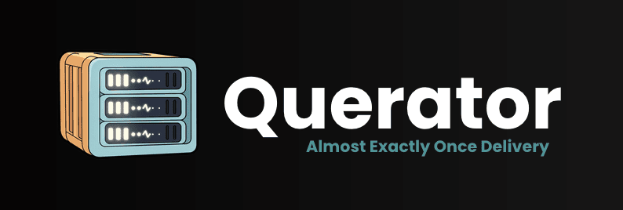

<h2 align="center">
<br />
</h2>

[](https://github.com/kapetan-io/querator/actions)
[](https://goreportcard.com/report/github.com/kapetan-io/querator)
[](https://opensource.org/licenses/Apache-2.0)
[](https://coveralls.io/github/kapetan-io/querator?branch=main)
[](https://pkg.go.dev/github.com/kapetan-io/querator)

Querator is a highly scalable, high performance **Almost Exactly Once
Delivery** (AEOD) Queue system designed to enable developers to build
event-driven, highly resilient, distributed, high-performance applications. The
project is inspired by production systems that we developed to scale SaaS companies like
Mailgun from millions to billions of events per day.

### Almost Exactly Once Delivery With Querator
At the heart of Querator is the Almost Exactly Once Delivery FIFO queue, backed by a database of your choice.

We say **“Almost” Exactly Once** because [Exactly Once Delivery (EOD) is theoretically impossible](https://bravenewgeek.com/you-cannot-have-exactly-once-delivery/).
However, in practice, you can achieve AEOD—or “Almost Exactly Once Delivery”—which is functionally equivalent to EOD, 
with the understanding that occasional duplicate deliveries may occur due to system failures.

From our extensive experience operating EOD systems at scale, the likelihood of duplicate delivery and processing 
is about the same as your system’s overall failure rate. In other words, message delivery is only as reliable as 
the system it runs on. Remember, [Distributed systems are all
about trade-offs](https://www.infoq.com/articles/cap-twelve-years-later-how-the-rules-have-changed/).

Anyone claiming their system provides, precise EOD is being disingenuous at best.

#### Exactly Once with Lease
Unlike streaming or other queue systems, Querator is designed from the ground up to provide high throughput
access to items in the queue via a [Lease](https://en.wikipedia.org/wiki/Lease_(computer_science)). When a consumer 
pulls an item off the queue there is an implicit **lease** created between the consumer and Querator. The 
consumer gains exclusive right to process that item, until such time as they mark the item as **complete** 
or tell Querator to **retry** the item by releasing the **lease** and giving the item to another consumer 
immediately, or at some future date and time.

The concept of a **lease** provides users of Querator with proof the item was delivered and provides assurances
that the item was processed by the consumer! In this way, you can sort of think of a **lease** as a locking 
primitive for processing items. A Consumer can hold on to the lease until the agreed upon timeout, it can hold 
off marking the lease as complete until it has processed the item that it consumed. As a result, you can use the
locking primitive the lease provides to solve several distributed problems.

- Implement the Saga Pattern for distributed transactions
- Use it as a FIFO queue with ordered delivery of messages
- Use it as a limit locking system, where items in the queue represent a limited lockable resource

#### Scheduled Delivery
Querator also supports scheduled delivery of the item queued. Given a specific `enqueue_at` querator
will defer enqueue of that item until the specified time. Retries can also specify a future **retry** time such
that the retried item will not be enqueued to be processed until the specified time is reached.

### Does Querator scale?
YES! We scaled a closed source version of the Querator queue service at https://mailgun.com to multi-billions of
messages a day in a very efficient and cost-effective manner, Meta (aka FaceBook) 
[built a similar system](https://engineering.fb.com/2021/02/22/production-engineering/foqs-scaling-a-distributed-priority-queue/) which
scaled to billions of messages. The closed source version of Querator we ran at mailgun was such a success I'm was 
surprised to find no similar projects available in the open source community, so I'm building one!

## Quick Start

Get started with Querator in seconds using Docker:

### Prerequisites
- [Docker](https://docs.docker.com/get-docker/) installed

### Start Querator
```bash
# Clone the repository
git clone https://github.com/kapetan-io/querator.git
cd querator

# Start Querator with docker compose
docker compose up -d
```

Check that Querator is running and healthy:
```bash
curl -s http://localhost:2319/health | jq .
```

### Producing & Consuming Events
Each method is reachable over HTTP using either binary protobuf (`Content-Type: application/protobuf`,
the default for the Go client) or JSON (`Content-Type: application/json`); the same message shape
on the wire either way. The structures below show that shape.

#### Producing (creating) an event
An item is produced to a queue with `QueueProduceRequest`. A single request can carry a batch of
items. An example produce request sent over the wire might look like the following.

```yaml
# QueueProduceRequest
queue_name: events
request_timeout: 30s
items:
    kind: user.signup
    bytes: '{"user_id":"u-1234"}'
```

#### Consuming (leasing) an event
A consumer leases a batch of items with `QueueLeaseRequest`. The lease grants exclusive ownership
of those items until they are completed, retried, or the lease expires. An example lease request
might look like the following.

```yaml
# QueueLeaseRequest
queue_name: events
batch_size: 10
client_id: consumer-1
request_timeout: 30s
```

The server replies with a `QueueLeaseResponse`, which might look like the following.

```yaml
# QueueLeaseResponse
queue_name: events
partition: 0
items:
    id: 0194a3c2-d1f0-7a6b-9c0e-3f2b1a0d4e5f
    kind: user.signup
    attempts: 0
    lease_deadline: 2026-06-01T12:01:00Z
    bytes: <payload>
```

#### Completing an event
After processing, mark the item complete with `QueueCompleteRequest` so it is removed from the
queue. An example complete request might look like the following.

```yaml
# QueueCompleteRequest
queue_name: events
partition: 0
request_timeout: 30s
ids:
    0194a3c2-d1f0-7a6b-9c0e-3f2b1a0d4e5f
```

If processing fails, send a `QueueRetryRequest` instead to release the lease and return the item to
the queue (optionally at a future `retry_at` time, or with `dead: true` to move it straight to the
dead letter queue). Doing nothing also works; the item is re-offered to another consumer once the
`lease_deadline` passes.


## Storage Backends
Each partition is supported by a user-selected data store backend. This separation of storage from processing gives
operators the flexibility to choose the desired level of fault tolerance for their specific deployment, and allows
them to use a data store they are already familiar with in terms of operation and scaling. Each partition is backed
by a single table, collection, or bucket (depending on the backend), making it easy to add or remove partitions as
throughput requirements change or as items are drained from the partition backends.

Unlike similar queue systems, Querator manages the complexity of partitioning and balancing on the server side,
simplifying the client API. This design choice makes it easy to integrate Querator with third-party systems, 
frameworks, and languages, fostering a rich open-source ecosystem.

The only requirement for databases is support for ordered primary keys. With just this requirement, Querator can
work with any database that implements the storage backend interface. Support for transactions and secondary
indexes is not required, but can be used to improve Querator’s reliability and performance.

### Storage Backends
Querator supports multiple storage backends for different deployment scenarios. See the
[Storage Documentation](docs/storage/README.md) for detailed configuration options for BadgerDB, PostgreSQL,
MongoDB, and InMemory backends.

##### InMemory
This backend stores all queues and items into RAM memory. This is useful when testing and creating a baseline for 
benchmarking Querator operation. It can also be used in ephemeral environments where speed is valued over durability.

##### BadgerDB
This backend uses [BadgerDB from DGraph](https://github.com/dgraph-io/badger) and is intended to be used for embedded
or in limited resource environments where High Availability is not a concern.

##### PostgreSQL
This backend uses PostgreSQL for production deployments requiring high availability and horizontal scaling.
See [PostgreSQL Storage Documentation](docs/storage/postgres.md) for configuration details.

##### MongoDB
This backend uses MongoDB for production deployments. Querator needs only ordered primary keys, so the
backend is non-transactional and runs against a standalone `mongod` (no replica set) as well as a managed
cluster. See [MongoDB Storage Documentation](docs/storage/mongodb.md) for configuration details.

##### Planned Backends
- MySQL

## Installation

#### Homebrew (macOS/Linux)
```bash
brew tap kapetan-io/kapetan
brew install querator
```

#### From Source
```bash
go install github.com/kapetan-io/querator/cmd/querator@latest
```

## Why Querator is built the way it is

Most queues make you pick between losing work and doing it twice. Querator is built around a simpler idea. When
a consumer takes an item, it gets a **lease**, a short exclusive claim on that item. Finish the work and mark
it complete, and the item is gone. Crash, and the lease runs out and someone else picks it up. You might process an
item twice after a failure. You will not silently lose one.

Features below that work today are marked **Shipped**. Features we have designed but not built are marked
**Planned**.

### Bad items can't block good ones

* **Shipped: failed items go to the back of the line.** If an item is retried or its lease runs out, it rejoins
  the queue at the tail. One poison item can't sit at the front and hold up everything behind it.
* **Shipped: max attempts and dead-letter queues.** Set a limit and an item that keeps failing moves to a
  dead-letter queue, where you can look at it later. A consumer can also send an item there on purpose with
  `dead: true`.
* **Shipped: scheduled delivery.** Produce with `enqueue_at`, or retry with `retry_at`, and the item stays hidden
  until that time.

### Fast without leaning on your database

* **Shipped: one goroutine runs each logical queue.** All reads and writes for a logical queue go through a single
  goroutine, which batches them into one database call. Querator does the coordination itself, so your database
  isn't doing locking on every request.
* **Shipped: overload shedding.** If requests pile up faster than the queue can take them, new ones get a
  "try again later" reply instead of building an unbounded backlog.

### Scales by adding partitions

A queue is made of logical queues, and a logical queue is made of partitions. Each partition is one table,
collection or bucket in your database.


* **Shipped: partitions.** One partition gives you strict first-in-first-out order. If you need more throughput
  and can give up strict order, add partitions.
* **Shipped: work spread by load.** Querator decides which partition gets each item, so clients never pick one.
  Producers and consumers just talk to the queue.
* **Shipped: your database, your choice.** In-memory, BadgerDB, PostgreSQL and MongoDB all work. Any database that
  can keep rows in primary key order can be added. See [Storage Backends](#storage-backends).
* **Shipped: library or service.** Embed it in your Go program, or run it as a server speaking HTTP with protobuf
  or JSON.
* **Shipped: namespaces and roles.** Teams or tenants get their own namespaces, and API keys carry roles that limit
  what each key can reach.

### Where it's going

* **Planned: logical queues that follow your consumers.** Today every queue runs one logical queue. We plan to grow
  and shrink them with the number of consumers, so work stays evenly spread even with more consumers than
  partitions.
* **Planned: a cluster of Querator instances.** A leader will hand queues and partitions out across instances and
  rebalance as instances come and go. Until then, one instance owns a queue.
* **Planned: moving partitions without downtime.** Operators will be able to drain a partition and move its data
  to another store while the queue keeps running. A partition can be marked read-only today.

### Embedded Querator
Querator is a library that exposes all API functionality through `Service` method calls. Use the `daemon` package, or
call `service.New()` to get a `Service` to work with directly.

### HTTP API
See [Querator API Reference](https://querator.io/api) for API documentation

### Contributing 
- Join our [Discord](https://discord.gg/XwfBdN9wdg)
- Checkout [querator.io](https://querator.io/api) for the HTML OpenAPI docs

### Similar Projects
* https://engineering.fb.com/2021/02/22/production-engineering/foqs-scaling-a-distributed-priority-queue/
